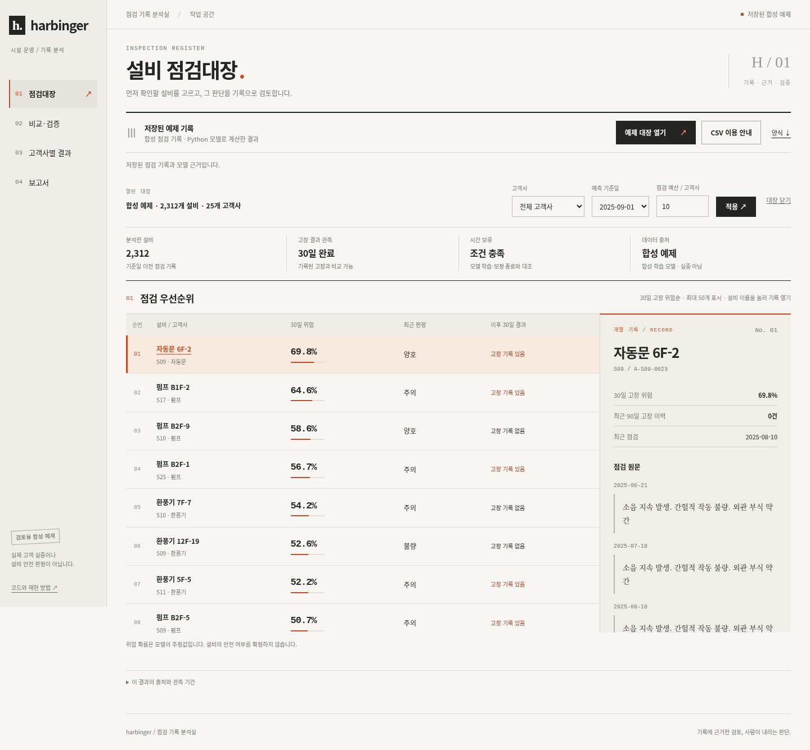

# harbinger · 점검 기록 분석실

**흩어진 시설 점검 기록에서 먼저 확인할 설비를 찾고, 판단 근거와 이후 고장 결과를 같은 화면에서 검증합니다.** 디더블유아이 AI 분석 서비스 개발자 지원용 포트폴리오입니다. 센서 설치나 유료 LLM API 없이 Python 모델과 FastAPI로 계산합니다.

모든 기본 예제와 아래 성능은 **합성 데이터**입니다. 실제 고객 실증, 안전 판정, 수리의 인과 효과를 주장하지 않습니다.

## 직접 사용하기

1. **예제 대장 열기** → 고객사와 과거 기준일을 선택합니다.
2. 설비 이름을 눌러 **점검 원문·고장 이력·모델 기여도**를 확인합니다.
3. **비교·검증**에서 동일한 날짜·설비·점검 예산으로 규칙, 로지스틱, 현재 모델, 메모/이력 제거 모델을 비교합니다.
4. 관측이 부족한 날짜는 **평가 보류**로 표시합니다. 고객사별 결과와 별도 LOSO 실험을 구분합니다.
5. 예제 CSV를 내려받아 업로드하거나, 분석 결과를 **CSV·JSON·한국어 Markdown 보고서**로 내려받습니다.

[공개 데모 주소](https://sokldjs554.github.io/harbinger/)는 **저장된 합성 모델 응답을 재생하는 정적 사이트**입니다. 이 브랜치의 새 배포 확인 여부는 [검증 기록](docs/verification/README.md)에 명시합니다. 공개 페이지는 CSV를 서버에 보내거나 임의 날짜의 모델을 계산하지 않습니다. **실제 업로드·추론은 아래 로컬 서버에서 동작합니다.**

새 화면은 왼쪽 기능 목록, 중앙 설비 대장, 오른쪽 개별 기록으로 구성합니다. 모바일에서는 설비 기록을 열고 돌아가기 또는 Esc로 대장에 복귀합니다.

[80초 사용 영상](docs/demo/walkthrough.mp4) · [모바일 검증 화면](docs/verification/ledger-static/mobile.png)



## 실행

Python 3.12 / Linux CPU를 기준으로 의존성을 고정했습니다. 최초 설치에는 패키지 다운로드가 필요합니다. 데이터·모델은 Git에 포함하지 않고 재현 명령으로 생성합니다.

```bash
python3.12 -m venv .venv
source .venv/bin/activate
pip install --index-url https://download.pytorch.org/whl/cpu 'torch==2.14.1+cpu'
pip install -c constraints.txt -e '.[dev]'
export OMP_NUM_THREADS=1 OPENBLAS_NUM_THREADS=1
harbinger bootstrap --data data --models models --artifacts artifacts
harbinger serve --port 8000
```

`http://localhost:8000/console/`을 열면 됩니다. OpenAPI는 `/docs`, 상태는 `/health`입니다. 기본 bootstrap은 축소 합성 데이터를 학습하므로 이 문서의 전체 실험과 수치·버전이 다릅니다. 새 환경에서 첫 부트스트랩은 수 분 이상 걸릴 수 있습니다.

문서와 같은 25개 사이트·36개월·시드 20260101의 전체 실험:

```bash
export OMP_NUM_THREADS=1 OPENBLAS_NUM_THREADS=1
harbinger synth --out data --seed 20260101 --scale 1 --months 36
harbinger features --data data
harbinger eval --data data --models models --artifacts artifacts --seed 20260101
python scripts/make_replay_summary.py
python scripts/fill_numbers.py
python scripts/build_workbench_demo.py
```

수정 후 전체 평가는 이 환경에서 약 26분 걸렸습니다. CPU·패키지·스레드 설정에 따라 달라집니다. 새 실행은 새 모델 버전을 생성합니다. 논문 수준의 다중 시드 강건성 실험은 수행하지 않았습니다.

```bash
# Docker: 최초 시작에서 축소 예제 학습 후 서버 시작
# 현재 컨테이너 실행 검증 상태는 docs/verification/README.md 참고
docker compose up --build api
```

컨테이너는 비루트 UID 10001로 실행하도록 구성했습니다. 외부 공개 운영에 필요한 인증·테넌트 권한·요청 속도 제한은 별도 구현이 필요합니다. 기본 공유 예제 변경 API는 비활성화하며 업로드는 독립 세션을 사용합니다.

## 입력 계약

UTF-8/BOM CSV, 최대 **5 MiB / 20,000행 / 설비 500개 / 고객사 10개 / 관측 5년**. 한 행은 점검 또는 고장·예방정비·부품 교체 기록입니다. 필수 열, 열거값, 날짜, 중복 ID, 설비 정보 불일치, 미지원 열을 검사하고 이유와 행 번호를 반환합니다. 자동으로 결측 정답을 음성으로 채우지 않습니다.

- [전체 열 명세와 예제](docs/upload-format.md)
- `GET /v1/workbench/example.csv`: 지원 형식 예제 다운로드
- `POST /v1/workbench/upload?observation_end=YYYY-MM-DD`: `Content-Type: text/csv`, 원문 CSV body
- 업로드는 메모리에서 최대 30분, 최대 8세션·동시 계산 2개로 제한합니다. 종료/만료 시 제거하며 원문을 파일이나 로그에 저장하지 않습니다.
- 관측 종료일까지 고장 이력이 완전하다는 사용자 선언이 필요합니다. 실제 기록 누락을 프로그램이 증명할 수는 없습니다.
- 업로드에서는 에너지 자료를 받지 않습니다. 에너지 특징은 결측으로 처리하며 합성 학습 모델을 탐색적으로 적용합니다.

## 평가 오류 수정과 재측정

점검 시각만으로 구간을 나누면 학습 말미의 점검이 **다음 구간에 발생한 고장을 정답으로 사용**했습니다. 학습·보정 cutoff에서 분류 정답의 30일 성숙 여부와 생존의 관측 시간을 함께 제한했습니다. 미래 자료가 바뀌어도 과거 입력·정답·학습 결과가 바뀌지 않는 회귀 테스트를 추가했습니다. 에너지 전처리의 미래 자료 fallback, 고객사 자체 정답 보정, 조기종료, 모델 관측 메타 없는 과거 재현도 점검했습니다.

수정 전 코드 `fd346c7`과 수정 후 코드를 동일 원자료·패키지·시드로 다시 실행했습니다. 기존 README 숫자를 수정 전 실행값으로 대체하지 않았습니다. **동일한 성숙 테스트 18,439행** 비교입니다.

| 지표 | 수정 전 재실행 | 수정 후 |
|---|---:|---:|
| AUROC ↑ | <!-- num:before_after.before.auroc|.4f -->0.7736<!-- /num --> | <!-- num:before_after.after.auroc|.4f -->0.7696<!-- /num --> |
| PR-AUC ↑ | <!-- num:before_after.before.pr_auc|.4f -->0.2520<!-- /num --> | <!-- num:before_after.after.pr_auc|.4f -->0.2445<!-- /num --> |
| Brier ↓ | <!-- num:before_after.before.brier|.4f -->0.0680<!-- /num --> | <!-- num:before_after.after.brier|.4f -->0.0684<!-- /num --> |
| ECE ↓ | <!-- num:before_after.before.ece|.4f -->0.0061<!-- /num --> | <!-- num:before_after.after.ece|.4f -->0.0092<!-- /num --> |

성능은 낮아졌습니다. 학습 3,575행·보정 3,568행의 미성숙 분류 정답을 제외했습니다. 생존은 해당 경계에서 중도절단합니다. 관측이 부족한 360일 Brier는 보류합니다. 경계·전처리·관측 종료 수정이 함께 적용됐으므로 변화 전체를 한 수정의 인과 효과라고 해석하지 않습니다.

## 무엇이 실제로 도움이 됐나

| 입력 조건 | 시간 보류 AUROC | 시간 보류 PR-AUC |
|---|---:|---:|
| 전체 모델 | <!-- num:ablation.full(+energy).auroc|.4f -->0.7696<!-- /num --> | <!-- num:ablation.full(+energy).pr_auc|.4f -->0.2445<!-- /num --> |
| 메모 및 메모 파생 특징 제거 | <!-- num:ablation.full−text.auroc|.4f -->0.7702<!-- /num --> | <!-- num:ablation.full−text.pr_auc|.4f -->0.2463<!-- /num --> |
| 고장·정비 이력 제거 | <!-- num:ablation.full−history.auroc|.4f -->0.7467<!-- /num --> | <!-- num:ablation.full−history.pr_auc|.4f -->0.2183<!-- /num --> |

**고장 이력은 기여했지만, 전체 모델에서 메모의 추가 성능 이득은 확인하지 못했습니다.** 메모는 원문 검토와 설명에는 쓰이지만, 텍스트 모델을 붙였다는 이유만으로 차별성을 주장하지 않습니다.

처음 보는 합성 고객사 8곳의 LOSO 평균 AUROC는 전체 0.7706, 메모 제거 0.7620, 이력 제거 0.7429였습니다. 25곳 전체 LOSO가 아니며 고객별 변화도 일관되지 않습니다. 실제 고객 일반화나 통계적 유의성을 주장하지 않습니다. 자체 정답을 더한 보정도 항상 좋아지지 않았습니다.

주간 우선 점검 K=10의 고장 비율은 현재 모델 **<!-- num:patrol.methods.harbinger_hgb.precision_at_k|.1% -->24.8%<!-- /num -->**, 로지스틱 **<!-- num:patrol.methods.logistic.precision_at_k|.1% -->20.8%<!-- /num -->**, 최근 점검 판정 규칙 **<!-- num:patrol.methods.last_inspection.precision_at_k|.1% -->12.2%<!-- /num -->**, 무작위 기대치 **<!-- num:patrol.random_expected_precision|.1% -->7.2%<!-- /num -->**입니다. 현재 모델의 고객사 단위 bootstrap 95% 구간은 21.3–28.1%입니다. 현장의 숙련자 판단과 직접 비교한 결과는 아닙니다.

## 구현과 검증 자료

| 확인할 역량 | 코드·근거 |
|---|---|
| 데이터 처리와 품질 계약 | `api/upload.py`, `features/build.py`, [입력 명세](docs/upload-format.md) |
| 시간 경계·생존·보정·회귀 방지 | `models/common.py`, `eval/run.py`, `tests/test_observation_boundary.py` |
| 모델 개발과 기여도 실험 | HGB/로지스틱/Cox/AFT/PyTorch, [평가 계약](docs/evaluation.md), `artifacts/contribution.json` |
| 고객별 검증 | `artifacts/loso.json`: 선정·미선정·보류 조건과 자체 정답 기간별 결과 |
| API·웹·설명·다운로드 | `api/routers/workbench.py`, `api/analysis.py`, `console/workbench.js` |
| 재현·운영 | [검증 기록 및 미완료 항목](docs/verification/README.md), `Dockerfile`, `.github/workflows/ci.yml` |

```bash
ruff check src tests scripts
ruff format --check src tests scripts
pytest -q
python scripts/fill_numbers.py --check
# 별도 설치: pip install playwright && playwright install chromium
python scripts/check_browser.py --url http://localhost:8000/console/
python scripts/record_workbench.py --url http://localhost:8000/console/
```

모델 버전 **v20261021-103259**, 원자료 해시와 평가 파일 버전은 `artifacts/release.json`에 기록합니다. 모델·원자료 바이너리는 로컬 생성물이며 공개 정적 데모에는 합성 계산 응답만 넣습니다. 선택적 TensorFlow 패리티는 이번 버전에서 재실행하지 않았습니다. 기존 산출물은 `artifacts/archive/fd346c7/`와 Git 이력에 보존합니다.

[지원용 소개·시연 순서](docs/submission.md) · [회사·공고 조사 범위](docs/company-research.md) · [모델 설계](docs/modeling.md) · [한계](docs/limitations.md) · [실데이터 적용 체크리스트](docs/real-data-checklist.md)
