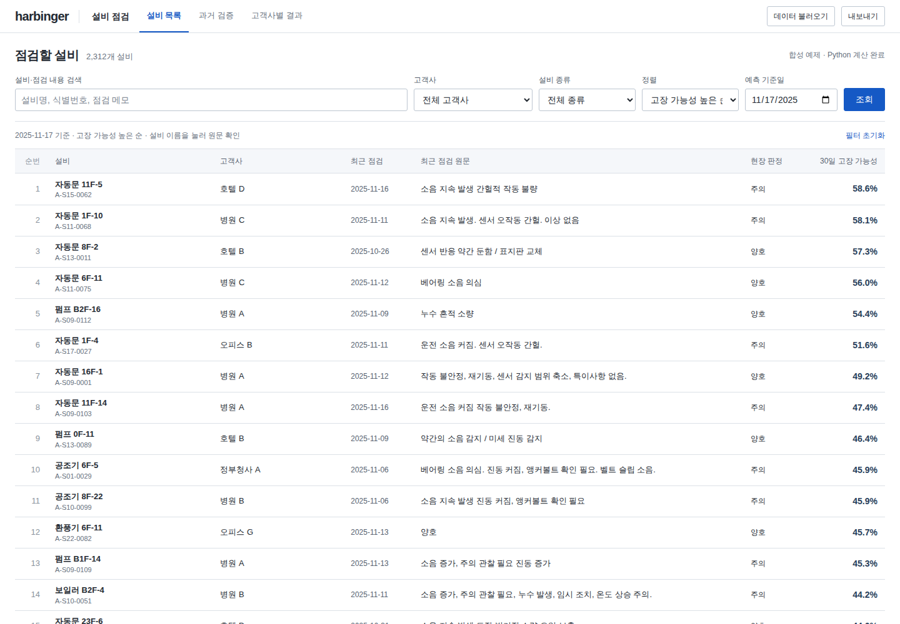

# 공개키를 등록하고 수정본을 AWS에 반영했습니다

검증일: **2026-10-25 한국 시간**. [실제 계산 데모](https://sokldjs554.github.io/harbinger/live.html) · [배포 실행의 두 번째 시도](https://github.com/sokldjs554/harbinger/actions/runs/40098079557/attempts/2)

입력 시각 중복, 고객사별 점검자 이력, 특징 캐시와 모니터링 보완을 기존 시드니 서버에 배포했습니다. 이 서버는 업로드 CSV로 새 결과를 계산합니다. 기본 자료와 학습 모델은 합성이며 실제 고객 실증 결과는 아닙니다.

| 확인 항목 | 이번 실행의 근거 |
|---|---|
| 배포 소스 | `e97a0a6c90a059dc549e453289416bf1d2be301b` |
| 학습 모델 | `v20261024-152504`, scale=1·36개월·seed=20260101, [생성 조건](deployment.json) |
| 기존 서버 재사용 | `i-0aaec13273afe3197`, `ap-southeast-2`, `created=false` |
| 전체 CI | [40098079564](https://github.com/sokldjs554/harbinger/actions/runs/40098079564): 같은 배포 소스에서 성공 |
| 배포 | [40098079557, attempt 2](https://github.com/sokldjs554/harbinger/actions/runs/40098079557/attempts/2): 성공 |
| 실제 AWS 브라우저 | [검사 결과](browser-checks.json): `static=false`, JavaScript 오류 0개 |
| HTTPS·재부팅·인증서 | 신뢰 가능한 HTTPS와 배포 소스 확인, 재부팅 후 복구, 인증서 갱신 모의시험 통과 |
| SSH 정리 | [배포 결과](deployment-result.json)의 `ssh_closed=true` |

전체 테스트의 최종 로컬 결과는 [136개 통과·선택적 TensorFlow 1개 제외](../audit-20261024/pytest-host-identity.txt)이며, 이번 배포 실행에서도 배포 안전성 테스트 32개를 다시 통과했습니다. [실행·아티팩트 정보](workflow.json)를 함께 보존합니다.

## 앞서 막혔던 공개키 확인

이전 성공 배포에서도 AWS 콘솔 출력에서 서버 공개키를 확인했지만, 해당 실행기의 임시 `known_hosts`에만 저장했습니다. 재배포 시 최신·기본 콘솔 출력 모두에서 키가 사라져 검증을 진행하지 못했습니다. 이것은 서버 키가 변경됐다는 증거가 아닙니다. [당시 진단](../audit-20261024/host-identity-diagnostics.json)을 보존합니다.

소유자가 AWS EC2 Instance Connect의 관리 연결에서 현재 공개키를 확인한 뒤, 인스턴스 ID와 함께 `AWS_EC2_SSH_HOST_IDENTITY`에 등록했습니다. 이번 실행은 등록값의 형식과 인스턴스 결합을 사전 검사하고, 실제 SSH 접속에서 등록된 서버 키를 엄격히 대조했습니다. 검증 우회 없이 접속·설치·검사를 완료했습니다. 이후에도 같은 서버의 콘솔 출력에 공개키가 없으면 등록값을 사용하며, 서버 교체 또는 키 변경 시에는 신뢰하는 경로로 다시 확인해야 합니다.

## 실제 서버에서 확인한 동작

- 설비 목록·상세, 점검일 전환, 돌아가기와 초점 복원
- 모델과 평가 표의 선택 대상 일치, 미적용 조건과 내보내기 분리, 관측 부족 시 평가 보류
- 고객사 선택과 CSV·JSON·Markdown 다운로드
- 정상 CSV의 실제 모델 계산, 잘못된 CSV·분석 실패 후 기존 자료 유지, 수식형 메모 처리
- 320·390·650px의 필터·조건 표시, 모바일 이동·스크롤 복원과 가로 넘침 검사
- 세션 종료, 업로드 후 새로고침 안내

[모바일 상세 캡처](mobile-detail.png)도 이번 AWS 브라우저 실행에서 생성했습니다. 전체 캡처와 자동 조작 영상은 [해당 실행의 아티팩트](https://github.com/sokldjs554/harbinger/actions/runs/40098079557/artifacts/12565471848)에 있습니다. 아티팩트 보존 기간은 14일이며, 핵심 JSON·평가 파일과 위 두 캡처는 이 저장소에 별도로 보존합니다.

## 결과의 범위

[이번 런타임 평가 파일](runtime/metrics.json)에서 HGB는 관측 완료 테스트 18,439행, AUROC 0.7696088847, PR-AUC 0.2444964125, Brier 0.0683772796입니다. 이전 합성 실험의 HGB 수치와 일치하며 새로운 현장 성능 개선으로 표현하지 않습니다. 배포 학습은 `--skip-loso`를 사용했으므로 이번 런타임에서 고객사 전체 LOSO를 다시 수행한 것은 아닙니다.

재부팅 복구와 인증서 갱신 모의시험은 이번 실행에서 통과했습니다. 장기간 무중단 운영, 실제 만료 시점의 갱신, 현장 데이터 일반화, 지인·고객 검토는 이번 배포로 입증되지 않습니다. AWS 계정의 실제 과금·크레딧 잔액도 이번 검사 범위에 포함하지 않았습니다.
