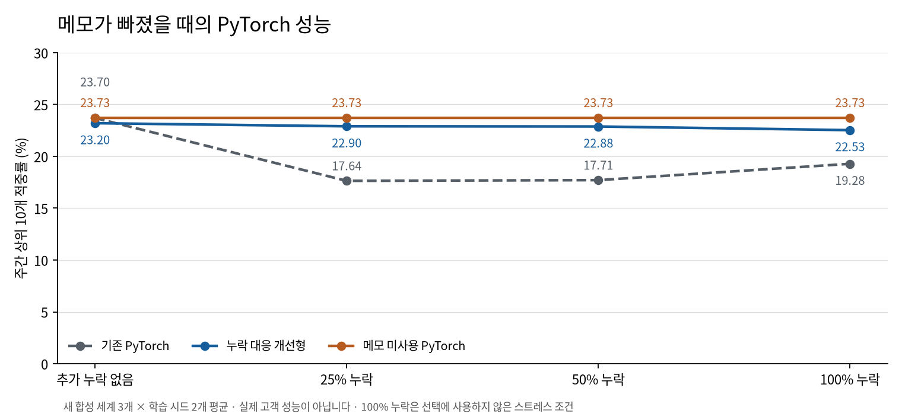

# 메모가 없어도 비교할 수 있도록

기존 PyTorch에 누락 대응 학습 경로를 추가하고, 처음 사용하는 합성 세계 3개 × 학습 시드 2개에서 비교했습니다. **사전에 정한 검증 선택 정책은 최종 테스트 채택 기준을 통과했습니다.** 복잡한 개선형을 일괄 채택하지 않고, 검증에서는 메모 미사용 모델 5회·기존 모델 유지 1회를 선택했습니다. 공개 서비스의 HGB는 유지합니다.

## 새 자료에서 확인한 결과

아래는 동일한 주간 날짜·설비·사이트별 점검 예산 10개에서 계산한 **선택 설비의 향후 30일 고장 비율**입니다. 6회 평균이며, 각 세계의 반복 학습 2회가 중첩된 합성 실험입니다. 메모 누락률은 원자료에 추가한 삭제 확률입니다.

| PyTorch 비교군 | 추가 누락 없음 | 25% 누락 | 50% 누락 | 100% 누락 | 정상 입력 Brier ↓ |
|---|---:|---:|---:|---:|---:|
| 기존 PyTorch | 23.70% | 17.64% | 17.71% | 19.28% | 0.06851 |
| 누락 대응 개선형 | 23.20% | 22.90% | 22.88% | 22.53% | 0.06920 |
| 메모 미사용 PyTorch | 23.73% | 23.73% | 23.73% | 23.73% | 0.06907 |
| 검증에서 고정한 선택 | 23.87% | 22.88% | 23.06% | 23.43% | 0.06891 |

개선형은 25% 누락에서 기존 **17.64% → 22.90%**로 높아졌지만, 정상 입력에서는 **23.70% → 23.20%**로 약 0.50%p 낮아졌습니다. 메모 미사용 모델은 네 조건의 예측이 완전히 같았고 평균 23.73%였습니다. 원문뿐 아니라 메모 파생 수치 특징도 제외했기 때문입니다.

검증에서 고정한 선택의 테스트 결과는 정상 입력 평균 **23.87%**, 누락25/50% 평균 향상 **약 5.30%p**였습니다. 정상 입력 Brier는 기존 0.06851에서 0.06891로 조금 나빠졌습니다. 순위 성능 개선과 확률 오차를 구분해 공개합니다. 100% 누락은 보고용이며 선택에는 사용하지 않았습니다.

## 선택을 고정한 뒤 확인했습니다

| 생성 / 학습 시드 | 검증에서 선택 | 테스트 정상 입력 변화 (%p) | 테스트 누락25/50 평균 변화 (%p) |
|---|---|---:|---:|
| 202610251 / 17 | 메모 미사용 PyTorch | +0.09 | +6.32 |
| 202610251 / 29 | 메모 미사용 PyTorch | +0.25 | +7.75 |
| 202610252 / 17 | 메모 미사용 PyTorch | -0.18 | +5.47 |
| 202610252 / 29 | 메모 미사용 PyTorch | -0.55 | +4.98 |
| 202610253 / 17 | 메모 미사용 PyTorch | +1.40 | +7.25 |
| 202610253 / 29 | 기존 PyTorch | +0.00 | +0.00 |

모든 실행에서 정상 입력 하락은2%p 이내였고 누락 조건 평균은 악화하지 않았습니다. 전체 평균 누락 향상2%p 이상, 정상 입력 하락1%p 이내, 정상 Brier 기존1.05배 이내도 충족했습니다. 이 기준은 사전 고정한 합성 실험 기준이며 현장 비용에서 도출한 고객별 운영 임계값이 아닙니다. [판정 원본](results/summary.json) · [방법·조건·재현 명령](method.md).

## 코드에서 바뀐 부분

- 선택형 `missing_aware=True`는 빈 메모 CNN 출력을0으로 게이트하고 존재 여부를 입력합니다. 학습 배치에서 확률0.35로 문자를 가립니다.
- 이 학습 경로에 메모 파생 수치가 포함되면 거부합니다. 추론에서 빈 문자열·None·공백은 누락으로, 알 수 없는 문자는 존재하는 입력으로 처리합니다.
- 기존 체크포인트와 기본 옵션은 유지합니다. 독립 검토에서 실제 이전 코드와 현재 기본 모델의 학습 상태·예측·로드 결과가 완전히 같음을 확인했습니다.

## 검증과 산출물 복구 기록

[독립 검토](review.md)에서 중대한 결함은 발견되지 않았습니다. 제안된 학습 입력 검사도 보완했습니다. 실제 마스킹을 제거한 별도 테스트 프로세스에서는 새 회귀 검사가 실패했고, 올바른 구현에서는 통과했습니다. [실패 재현](dropout-mutation-red.txt) · [전체 테스트](tests.txt): **168개 통과·선택적 TensorFlow 1개 제외**.

완료된 실험을 다시 읽는 중 압축 CSV2개가 끝까지 저장되지 않은 것을 발견했습니다. 정확한 절단 원인은 확인되지 않았습니다. 원자료 Parquet 해시와 예측 ZIP12개의 CRC는 모두 유효했습니다. 손상된 메모 파일은 원자료·고정 시드로 다시 변환했고, 평가 대상 파일은 동일 세계의 다른 학습 시드 기록과 대조했습니다. 두 파일의 남아 있는 전체 비압축 접두부가 복구 내용과 일치함을 확인했습니다.

**예측 배열·학습 가중치·선택 결과는 변경하지 않았습니다.** 복구 전 파일과 해시를 보존하고 [복구 근거](recovery/record.json)에 새 해시를 기록했습니다. 이후 CSV 저장은 임시 파일 완성·fsync·전체 압축 해제 검증 후 원자적으로 교체하며, 재검증 스크립트도 모든 압축 CSV의 구조를 검사합니다. [원시 결과 재검증](raw-verification.txt)은 지표·선택·시간 경계·메모 미사용 예측 불변·bootstrap까지 다시 계산해 통과했습니다.

## 이 결과로 판단할 수 있는 범위

누락 대응 개선형이 기존 PyTorch보다 누락 입력에서 나아졌고, 이 실험의 검증 선택에서는 더 단순한 메모 미사용 모델을 자주 선택했습니다. 입력·구조가 함께 바뀌어 개선 전체를 dropout 하나의 효과로 분리할 수는 없습니다. 실제 누락은 무작위 삭제와 다를 수 있습니다. HGB를 같은 새 세계에서 비교한 실험도 아니므로 HGB보다 우수하다고 주장하지 않습니다.

친구·동료의 사용성 검토는 [별도 근거](../../user-reviews/README.md)로 유지합니다. 실제 고객 성능을 확인하려면 실제 기록과 이후 고장 결과가 필요합니다. 고객별 자동 전환과 공개 PyTorch 모델 교체는 이번 결과만으로 수행하지 않았습니다.

실제 전체 학습 소스는 초기 공개 커밋 [ce7ec9a](https://github.com/sokldjs554/harbinger/commit/ce7ec9af237024ffae22944f6b25bfdd8ff7e0f3)의 모델·평가 코드와 같습니다. 세계별 provenance의 파일 해시로 연결합니다. 이후 압축 저장 경로만 보강했으며, [새 저장 경로 smoke](atomic-smoke.txt)의 예측 배열 24개는 이전 smoke와 완전히 같았습니다.
