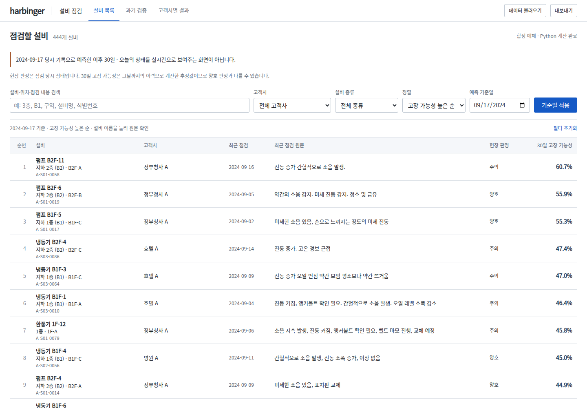
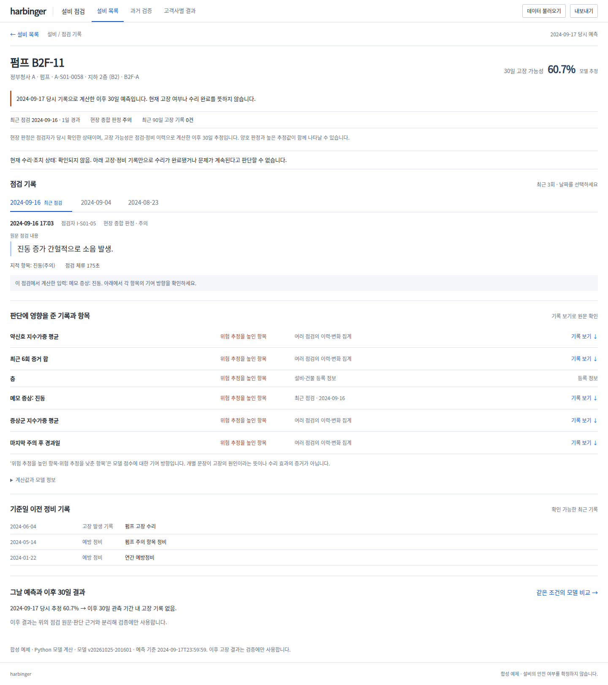
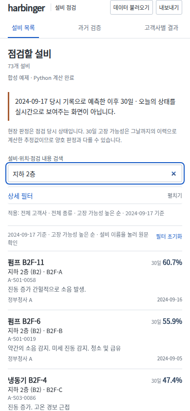
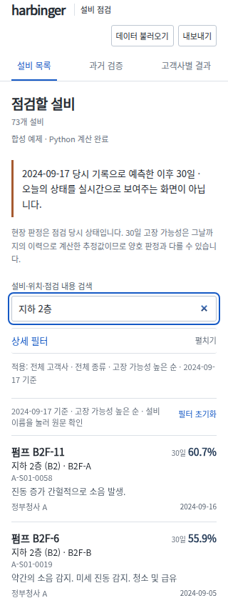
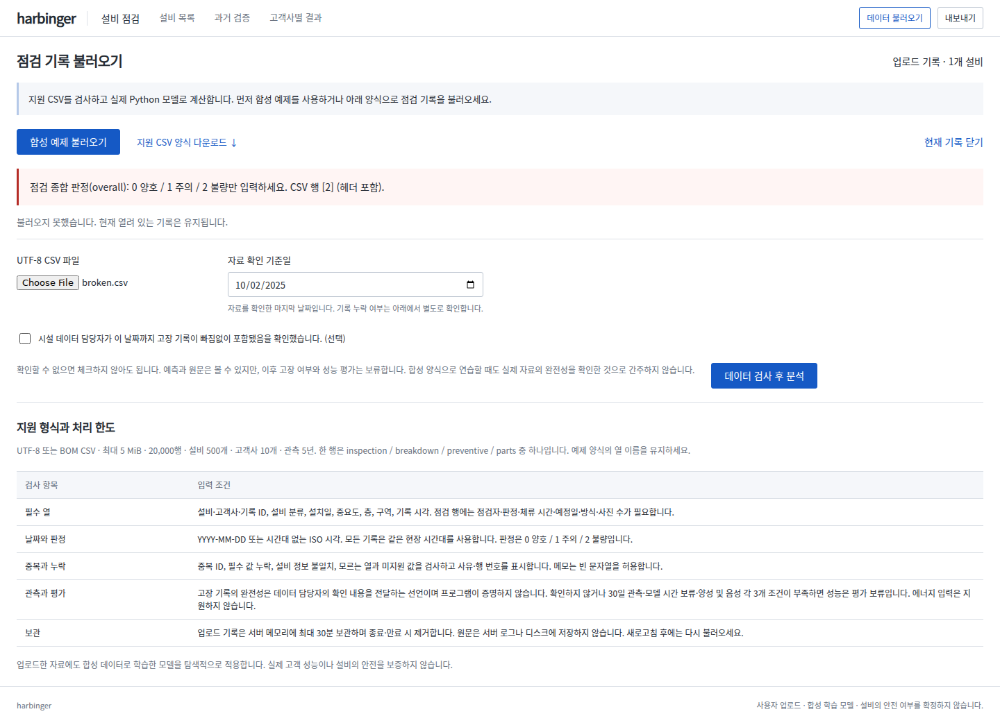

# 사용자 의견을 반영한 화면·업로드 개선

시설관리 동료 A와 비전공자 친구 B에게서 전달받은 의견을 바탕으로 기존 점검대장을 보완했다. [참가자 기록과 개선 대응](../../user-reviews/README.md)은 개발자 검증과 구분한다. B 기록의 시간 실측·직접 인용 여부는 미확인이고, 수정 후 참가자 재검토는 아직 수행하지 않았다.

## 바뀐 동작

- 등록된 층·구역·설비 ID를 목록과 상세에 표시하고 검색한다. `6층`은 16층을 포함하지 않으며 `지하 1층`·`B1`도 지원한다. 위치 정보는 원본에서 읽는다. 저장 예제는 동일 설비·기준일의 상세 응답이 있는 경우에만 위치를 표시한다.
- 예측 당시 날짜와 이후 30일을 화면 상단에 표시한다. 현장 판정과 모델 추정은 구분한다. 현재 수리·조치 상태는 자료가 없어 ‘확인되지 않음’으로 표시하고 고장 기록을 완료된 수리로 부르지 않는다.
- 기준일을 바꾸면 미적용 안내가 나오며 기존 결과의 날짜를 유지한다. 계산 실패 시 목록과 보고서의 기존 결과를 보존한다.
- 기록 완전성을 확인하지 못해도 CSV 탐색·예측은 가능하다. API 기본값은 미확인이고, 이후 고장 여부·고객별 고장 수·모든 성능 지표와 다운로드는 보류한다. 확인한 자료라도 기존 기간·시간 보류·표본 조건을 통과해야 성능을 공개한다.
- 파일·날짜 변경과 자료 전환 시 확인란을 해제한다. 기본 숫자 열의 오류는 한국어 의미·허용값·헤더 포함 CSV 행 번호를 제공한다.

## 검증 근거

- [전체 테스트](tests.txt): **152 passed, 1 skipped**, 41.78초. 선택적 TensorFlow 패리티 1개 제외.
- [수정 전 API 회귀 실패](regressions-before.txt): 미확인 자료를 완전한 정답으로 표시하던 동작, 숫자 오류 안내를 재현했다. [원래 위치 표시](location-before.txt), [층 부분 일치](floor-before.txt)도 실패 후 수정했다.
- [독립 검토](review.md)에서 자료 전환 시 확인란이 남는 결함을 발견했다. [수정 전 브라우저 실패](confirmation-before.txt)를 재현한 뒤 수정했고 최종 실제 API 브라우저 전체 검사가 통과했다.
- [실제 API 브라우저 검사](live-checks.json) · [추가 검사](live-review-checks.json): 정상/오류 CSV, 실제 모델 계산, 조건·내보내기 보존, 미확인 평가 보류, 직접·프로그램 날짜 변경 시 확인 해제, 위치 검색, 원문·복귀·초점·모바일 전 화면. JavaScript 오류 0개.
- [저장 예제 브라우저 검사](static-checks.json) · [추가 검사](static-review-checks.json): 동일 탐색·날짜·내보내기·모바일 흐름. JavaScript 오류 0개.
- 320·390·650px에서 ID·위치 표시와 가로 넘침을 확인했다. 1440px 데스크톱도 조작했다. 한글 Noto Sans CJK KR을 설치한 환경에서 캡처했다.
- Ruff 검사·포맷, README 수치, 릴리스 해시 검사 통과. [소스 해시·모델·검사 메타데이터](checks.json).

로컬 API는 실제로 학습된 축소 합성 모델 `v20261025-201601`을 사용했다. 저장 예제 모델은 기존 `v20261021-103259`를 유지했다. 학습 알고리즘·합성 성능 결과는 이번 변경 대상이 아니다. AWS 배포 절차는 기존 정책상 전체 합성 번들을 새로 학습하므로 배포 모델 버전은 해당 실행 결과로 따로 확인한다.

## 통합·공개 배포 근거

- [PR #12](https://github.com/sokldjs554/harbinger/pull/12) 병합 소스: `496590191cf8222870fd7f3063041080472f0246`.
- [PR CI·Docker](https://github.com/sokldjs554/harbinger/actions/runs/40188993266)와 [병합본 CI·Docker](https://github.com/sokldjs554/harbinger/actions/runs/40189712993) 통과.
- [저장 예제·80초 영상 공개 배포](https://github.com/sokldjs554/harbinger/actions/runs/40189712994) 통과. 공개 파일 일치 및 AWS HTTPS health 검사도 이 실행에서 통과했다.
- [AWS 실제 계산 배포 실행](https://github.com/sokldjs554/harbinger/actions/runs/40189712992)은 전체 합성 모델 준비, HTTPS, 재부팅, 인증서 갱신 모의시험, 실제 브라우저 과업, 임시 SSH 규칙 제거를 수행한다. **최종 배포 성공 여부는 해당 실행의 conclusion과 `aws-deployment-verification` 산출물로 확인한다.** 모델 버전·생성 여부·실제 주소도 해당 산출물에 기록된다. 로컬 검사나 배포 시작을 공개 배포 성공으로 간주하지 않는다.

현재 작업 환경의 직접 IP HTTPS 접속은 프록시 인증서의 주소 불일치로 검증할 수 없었다. 진단 시 수신한 인증서는 OpenAI 프록시 발급 인증서였다. 공개 HTTPS 검증은 인증서 확인을 유지한 GitHub Actions 결과를 근거로 삼는다.

## 화면

